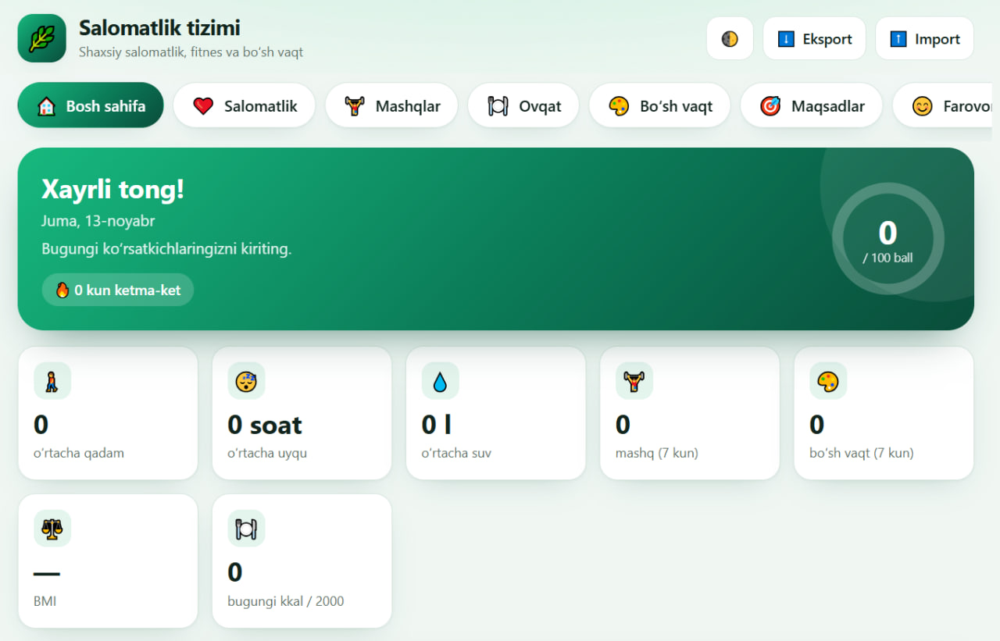
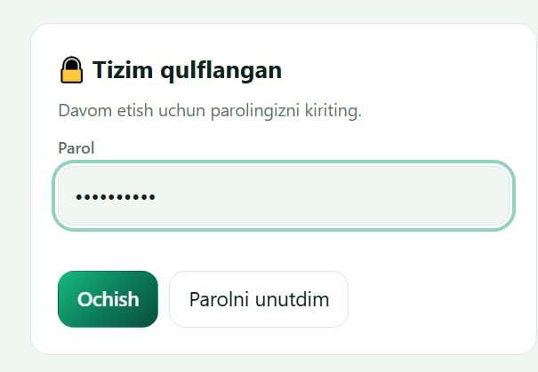
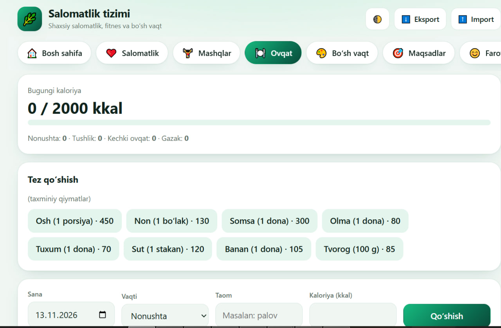
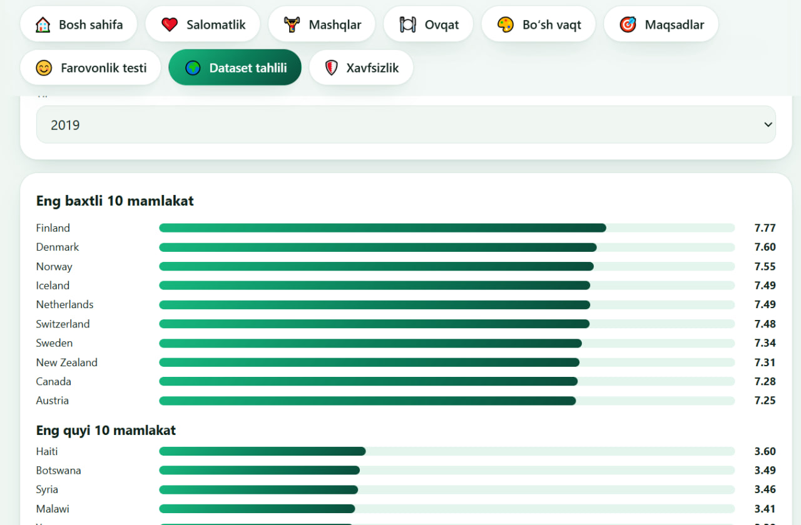
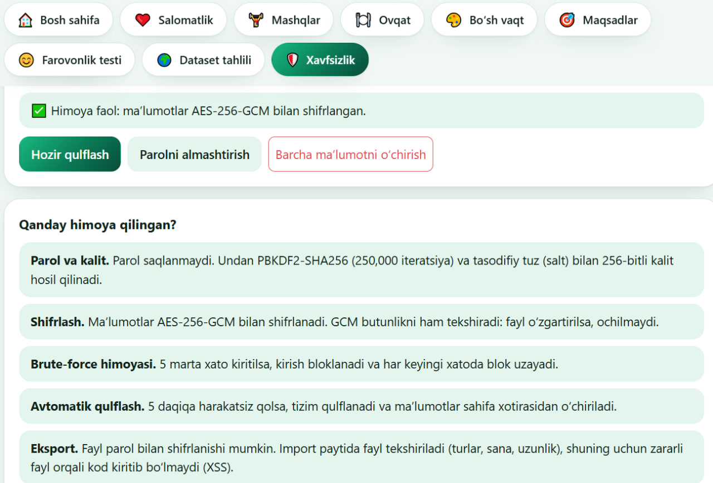

# Shaxsiy salomatlik, fitnes va bo'sh vaqt tizimi

**Personal Health, Fitness & Leisure Activity Management System**

Foydalanuvchi o'z salomatligi, mashqlari, ovqatlanishi va bo'sh vaqtini bir joyda kuzatib boradigan veb-ilova. Barcha ma'lumotlar faqat foydalanuvchining brauzerida, shifrlangan holda saqlanadi.

## Havolalar
- Ilova: HAVOLA_SHU_YERGA
- Dataset: Kaggle, World Happiness Report (2015-2019)

## Imkoniyatlar
- Salomatlik: vazn, qadam, uyqu, suv, puls, kayfiyat, BMI
- Mashqlar va taxminiy yoqilgan kaloriya
- Ovqat jurnali va kunlik kaloriya maqsadi
- Bo'sh vaqt mashg'ulotlari
- Maqsadlar, haftalik farovonlik balli, streak va nishonlar
- Farovonlik testi
- World Happiness dataset tahlili: reyting, korrelyatsiya, mamlakatlarni solishtirish
- Eksport va import, qorong'i rejim, telefonga moslashgan dizayn

## Axborot xavfsizligi
- Parol bilan kirish: PBKDF2-SHA256 (250 000 iteratsiya) va tasodifiy tuz
- Ma'lumotlarni AES-256-GCM bilan shifrlash
- Noto'g'ri parolni 5 marta kiritganda kirishni bloklash
- 5 daqiqa harakatsiz qolganda avtomatik qulflash
- Parol bilan shifrlangan eksport fayli
- Import qilinadigan faylni tekshirish va HTML escape (XSS himoyasi)
- Ma'lumotlar hech qaysi serverga yuborilmaydi

## Texnologiyalar
HTML, CSS, JavaScript, Web Crypto API. Joylashtirish: Google Cloud Platform (Firebase Hosting).

## Ishga tushirish
`index.html` faylini brauzerda oching yoki yuqoridagi havolaga kiring. Birinchi kirishda parol o'rnatiladi.
Parolni unutsangiz, ma'lumotlarni tiklab bo'lmaydi.

## Ekran rasmlari

